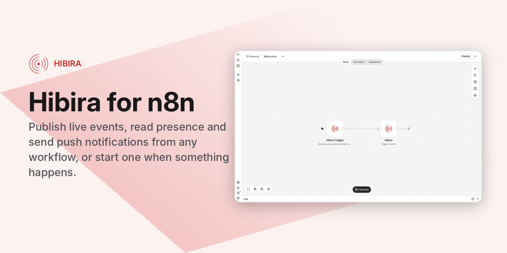

# n8n-nodes-hibira



n8n community nodes for [Hibira](https://hibira.io), the hosted realtime WebSocket service that speaks the Pusher Channels protocol, with Beams-compatible push notifications.

- **Hibira**: publish realtime events from any workflow, read channel and presence state, close a user's connections, and send push notifications to iOS, Android and browsers.
- **Hibira Trigger**: start a workflow when a channel becomes occupied or empty, a user joins or leaves a presence channel, a client sends an event, and more.

[n8n](https://n8n.io/) is a [fair-code licensed](https://docs.n8n.io/sustainable-use-license/) workflow automation platform.

[Installation](#installation) · [Operations](#operations) · [Hibira Trigger](#hibira-trigger) · [Credentials](#credentials) · [Compatibility](#compatibility) · [Examples](#examples) · [Resources](#resources)

## Installation

Follow the [installation guide](https://docs.n8n.io/integrations/community-nodes/installation/) in the n8n community nodes documentation and install `n8n-nodes-hibira`.

## Operations

| Resource | Operation | What it does |
|---|---|---|
| Event | Trigger | Publish an event to up to 100 channels. Optionally exclude a socket ID and return each channel's subscription or user count. |
| Event | Update Live Chart | Update a live chart or poll opened through the Hibira MCP server: set or add to a number, add to one bar, set every bar, or reset it, with an optional goal, title, subtitle and status. The chart redraws at once. |
| Channel | Get | One channel's state (occupied, subscription count, user count). |
| Channel | Get Many | Occupied channels, one item per channel, optionally filtered by prefix. |
| Channel | Get Users | The users on a presence channel, one item per user (large presence channels are paged for you). |
| User | Terminate Connections | Close every connection of a signed-in user. |
| Push Notification | Publish to Interests | Send a notification to devices subscribed to interests. |
| Push Notification | Publish to Users | Send a notification to the devices of user IDs. |
| Push Notification | Delete User | Remove a user and their devices from push. |
| Approval | Request | Ask a person to approve or choose (2 to 4 options) through a Hibira-hosted answer link, and by default wait for the answer. |
| Approval | Get | The status of a request (`pending`, `approved`, `rejected`, `expired`) with the choice and comment, optionally waiting for the answer. |
| Waiting Room | Get | A waiting room's settings and queue counts (waiting, admitted, issued). |
| Waiting Room | Create or Update | Create a room (Admit per Minute is required) or change its state, rate, start time, title, burst, pass lifetime or return URLs. |
| Waiting Room | Admit | Let the next N visitors through now, on top of the steady rate. |
| Waiting Room | Verify Pass | Check a visitor's pass; outputs `valid`, `number`, `ticket_id` and `expires_at`. |
| Waiting Room | Delete | Delete a room and its queue. |

**Approvals** (human in the loop): *Request* returns `approval_id` and `url`, a link anyone can answer once (the first option approves, any other rejects). Send the link by email or chat, or let Hibira deliver it with **Push to Interests / User IDs** or announce it on a **Channel** for the [`@hibira-io/approvals`](https://www.npmjs.com/package/@hibira-io/approvals) inbox. With **Wait for Answer** on, the node holds the workflow until the person answers or **Max Wait** (up to 60 minutes) runs out, then outputs `status` and `choice`; route on `status` with an IF node. For longer waits, turn it off and check later with *Get*. Approvals need an app in a Hibira account and use the Hibira API credential.

**Waiting rooms** queue visitors on a Hibira-hosted page and send them back with a signed pass. Use the node to open a room on a schedule, pause it when stock runs out, admit a batch when a sale opens, or check a pass from a form or checkout webhook. Record `ticket_id` to allow one checkout per place in line. Waiting rooms need the waiting room add-on and use the Hibira API credential.

Push notifications take a **Simple** payload (title, body, link and data, sent to the platforms you choose) or your own **JSON** `apns`, `fcm` and `web` payloads, as in the Pusher Beams API.

The Hibira node can also be used as a tool by n8n AI agents.

## Hibira Trigger

Choose the events to start on:

| Event | Sent when |
|---|---|
| Channel Occupied / Channel Vacated | A channel gets its first subscriber, or loses its last |
| Member Added / Member Removed | A user's first connection joins a presence channel, or their last one leaves |
| Client Event | A client sends a `client-*` event |
| Cache Miss | A client subscribes to a cache channel with nothing cached |
| Subscription Count | A channel's subscription count changes (apps with subscription counting on) |
| Chat Message | A message is sent with the Chat API |

When the workflow is activated (or you click *Test this trigger*), the node adds its webhook URL to your Hibira app with those event types, and removes it again when the workflow is deactivated. Each request is checked against the app secret (`X-Pusher-Signature`, or `X-Hibira-Previous-Signature` while a rotated secret is in its grace period), and anything else is answered with 401.

Hibira batches webhook events for up to a second. By default the trigger outputs one item per event (`name`, `channel`, `user_id`, `event`, `data`, `socket_id`, `time_ms`); turn off **Split Into Items** to get each batch as one item. **Channel Prefix** keeps only events of matching channels.

Things to know:

- Your n8n must be reachable from the internet over https: Hibira only sends webhooks to public https addresses.
- Each webhook URL counts toward your plan's endpoints per app (1 on Free, 2 on Hobby, 3 on Starter, 5 from Pro). The test URL and the production URL are separate endpoints while both are registered.
- Webhooks are delivered at least once, so a workflow can occasionally run twice for the same event.

## Credentials

Create an app in the [Hibira portal](https://hibira.io/portal) and open its page.

**Hibira API** (events, channels, users and the trigger):

1. Copy the **App ID**, **Key** and **Secret** from the app page.
2. Leave **API URL** as `https://ws.hibira.io` unless you run a self-hosted cluster.

**Hibira Push API** (push notifications):

1. Turn on Push on the app page.
2. Copy the **Instance ID** and **Secret Key** from the Push section.

Both credentials have a connection test. Requests to the Channels API are signed with the app secret in the same way as the official Pusher server libraries, so the secret itself never leaves n8n.

## Compatibility

Built with `@n8n/node-cli` 0.54 and tested on n8n 2.45. Requires n8n 1.0 or later.

## Examples

- **Notify a team channel when a support room fills up**: Hibira Trigger (Member Added, Channel Prefix `presence-support-`) → Hibira Channel *Get* with User Count → Slack.
- **Broadcast new orders to dashboards**: Shopify or Stripe trigger → Hibira Event *Trigger* on `orders` with the order as data.
- **Remind abandoned carts by push**: Schedule → database query → Hibira Push Notification *Publish to Users*.
- **Ask a supervisor before a database change**: see the recipe below.

### Recipe: supervisor approval for database changes

Reads run by themselves; anything that could change data waits for a supervisor who sees the exact statement and its plan. n8n keeps the database credentials, so Hibira only carries the question and the answer.

1. **Trigger** with the statement in `sql`: a chat or form trigger, a webhook from your app, or an AI Agent's tool call.
2. **Code** (Run Once for Each Item) marks reads. It is deliberately strict: one statement, starting with a read word, with no word that writes. Anything unsure is a write.

   ```js
   const s = $json.sql.trim().replace(/;\s*$/, '');
   const read = !s.includes(';')
     && /^(select|with|explain|show)\b/i.test(s)
     && !/\b(insert|update|delete|merge|create|alter|drop|truncate|grant|revoke|copy|call|into|analyze|set|nextval|setval|for\s+(update|share))\b/i.test(s);
   return { json: { ...$json, read } };
   ```

3. **IF** `read` is true → **Postgres** (or MySQL) *Execute Query* with `{{ $json.sql }}`, using a database user that can only read.
4. Otherwise → **Postgres** *Execute Query* `EXPLAIN {{ $json.sql }}` for the plan and estimated rows (EXPLAIN without ANALYZE does not run it) → **Crypto** *Hash* SHA256 of `sql` into `fingerprint` → **Hibira** *Approval › Request*: Title `Run this change on the shop database?`, Details the statement, the plan and `SHA-256: {{ $json.fingerprint }}`, Wait for Answer on. Add **Push to User IDs** to reach the supervisor's phone, or a **Channel** to show the request and its answer live in your own app.
5. **IF** `status` is `approved` → **Crypto** *Hash* the `sql` again and check it equals `fingerprint` → **Postgres** *Execute Query* with that `sql`. On `rejected`, send the supervisor's `comment` back to the requester.

The same pattern, with live status in a web console and a phone approval page, is the [database changes guide](https://hibira.io/use-cases/database-write-approvals).

## Resources

- [n8n community nodes documentation](https://docs.n8n.io/integrations/#community-nodes)
- [Hibira](https://hibira.io) and its [Pusher protocol guide](https://hibira.io/pusher-protocol) (HTTP API, webhooks and signatures)

## License

[MIT](LICENSE)
