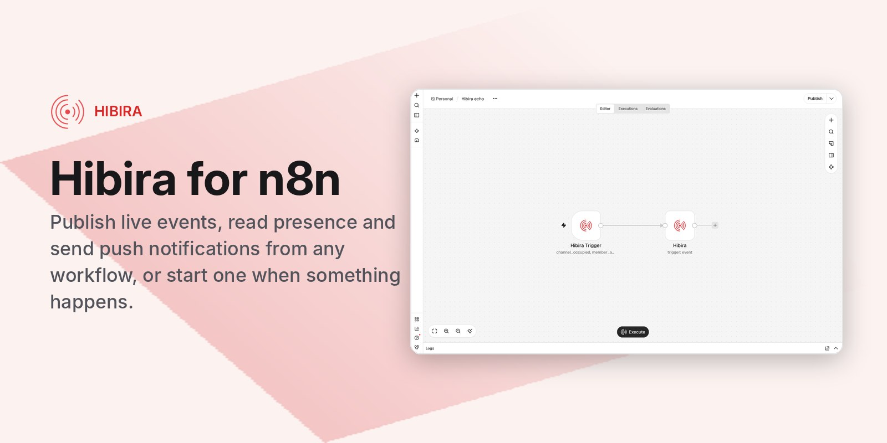

# n8n-nodes-hibira

n8n community nodes for [Hibira](https://hibira.io), the hosted realtime WebSocket service that speaks the Pusher Channels protocol, with Beams-compatible push notifications.

- **Hibira**: publish realtime events from any workflow, read channel and presence state, close a user's connections, and send push notifications to iOS, Android and browsers.
- **Hibira Trigger**: start a workflow when a channel becomes occupied or empty, a user joins or leaves a presence channel, a client sends an event, and more.

[n8n](https://n8n.io/) is a [fair-code licensed](https://docs.n8n.io/sustainable-use-license/) workflow automation platform.

[Installation](#installation) · [Operations](#operations) · [Hibira Trigger](#hibira-trigger) · [Credentials](#credentials) · [Compatibility](#compatibility) · [Examples](#examples) · [Resources](#resources)

## Installation

Follow the [installation guide](https://docs.n8n.io/integrations/community-nodes/installation/) in the n8n community nodes documentation and install `n8n-nodes-hibira`.

## Operations

| Resource | Operation | What it does |
|---|---|---|
| Event | Trigger | Publish an event to up to 100 channels. Optionally exclude a socket ID and return each channel's subscription or user count. |
| Channel | Get | One channel's state (occupied, subscription count, user count). |
| Channel | Get Many | Occupied channels, one item per channel, optionally filtered by prefix. |
| Channel | Get Users | The users on a presence channel, one item per user (large presence channels are paged for you). |
| User | Terminate Connections | Close every connection of a signed-in user. |
| Push Notification | Publish to Interests | Send a notification to devices subscribed to interests. |
| Push Notification | Publish to Users | Send a notification to the devices of user IDs. |
| Push Notification | Delete User | Remove a user and their devices from push. |

Push notifications take a **Simple** payload (title, body, link and data, sent to the platforms you choose) or your own **JSON** `apns`, `fcm` and `web` payloads, as in the Pusher Beams API.

The Hibira node can also be used as a tool by n8n AI agents.

## Hibira Trigger

Choose the events to start on:

| Event | Sent when |
|---|---|
| Channel Occupied / Channel Vacated | A channel gets its first subscriber, or loses its last |
| Member Added / Member Removed | A user's first connection joins a presence channel, or their last one leaves |
| Client Event | A client sends a `client-*` event |
| Cache Miss | A client subscribes to a cache channel with nothing cached |
| Subscription Count | A channel's subscription count changes (apps with subscription counting on) |
| Chat Message | A message is sent with the Chat API |

When the workflow is activated (or you click *Test this trigger*), the node adds its webhook URL to your Hibira app with those event types, and removes it again when the workflow is deactivated. Each request is checked against the app secret (`X-Pusher-Signature`, or `X-Hibira-Previous-Signature` while a rotated secret is in its grace period), and anything else is answered with 401.

Hibira batches webhook events for up to a second. By default the trigger outputs one item per event (`name`, `channel`, `user_id`, `event`, `data`, `socket_id`, `time_ms`); turn off **Split Into Items** to get each batch as one item. **Channel Prefix** keeps only events of matching channels.

Things to know:

- Your n8n must be reachable from the internet over https: Hibira only sends webhooks to public https addresses.
- Each webhook URL counts toward your plan's endpoints per app (1 on Free, 2 on Hobby, 3 on Starter, 5 from Pro). The test URL and the production URL are separate endpoints while both are registered.
- Webhooks are delivered at least once, so a workflow can occasionally run twice for the same event.

## Credentials

Create an app in the [Hibira portal](https://hibira.io/portal) and open its page.

**Hibira API** (events, channels, users and the trigger):

1. Copy the **App ID**, **Key** and **Secret** from the app page.
2. Leave **API URL** as `https://ws.hibira.io` unless you run a self-hosted cluster.

**Hibira Push API** (push notifications):

1. Turn on Push on the app page.
2. Copy the **Instance ID** and **Secret Key** from the Push section.

Both credentials have a connection test. Requests to the Channels API are signed with the app secret in the same way as the official Pusher server libraries, so the secret itself never leaves n8n.

## Compatibility

Built with `@n8n/node-cli` 0.54 and tested on n8n 2.45. Requires n8n 1.0 or later.

## Examples

- **Notify a team channel when a support room fills up**: Hibira Trigger (Member Added, Channel Prefix `presence-support-`) → Hibira Channel *Get* with User Count → Slack.
- **Broadcast new orders to dashboards**: Shopify or Stripe trigger → Hibira Event *Trigger* on `orders` with the order as data.
- **Remind abandoned carts by push**: Schedule → database query → Hibira Push Notification *Publish to Users*.

## Resources

- [n8n community nodes documentation](https://docs.n8n.io/integrations/#community-nodes)
- [Hibira](https://hibira.io) and its [Pusher protocol guide](https://hibira.io/pusher-protocol) (HTTP API, webhooks and signatures)

## License

[MIT](LICENSE)
